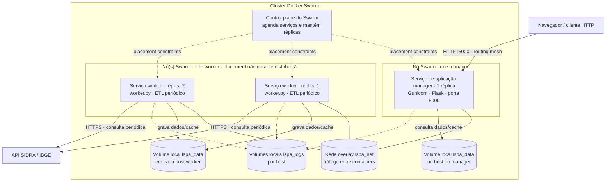
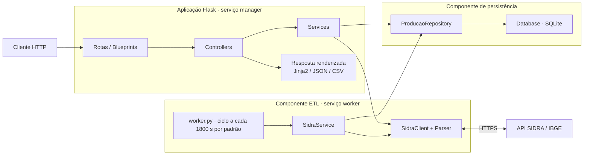
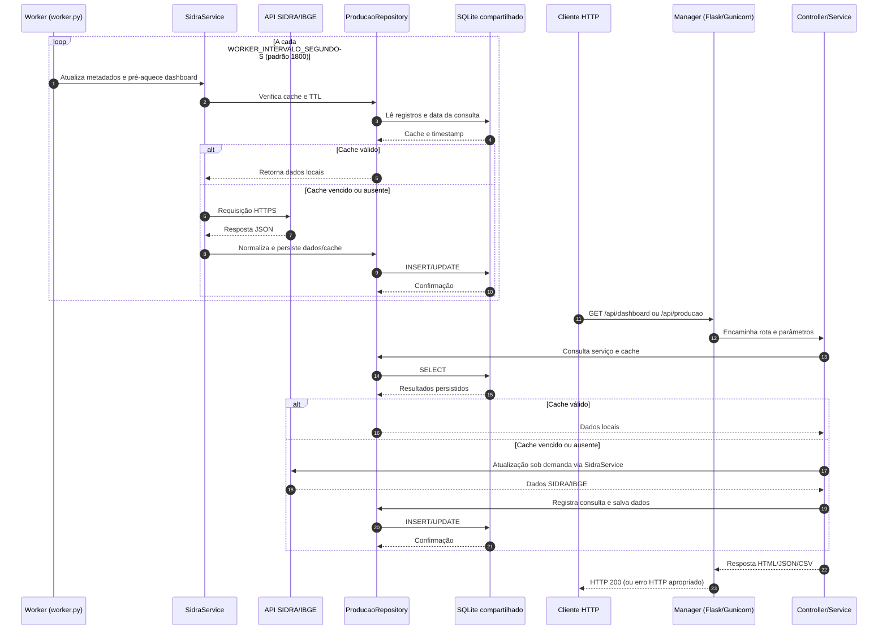

# LSPA-System — Análise da Produção Agrícola (IBGE)

Sistema web para consultar, processar e visualizar os dados do **LSPA — Levantamento
Sistemático da Produção Agrícola**, publicados pelo IBGE no
[SIDRA](https://sidra.ibge.gov.br/pesquisa/lspa/tabelas) e obtidos em tempo real pela
[API SIDRA](https://apisidra.ibge.gov.br/).

Desenvolvido em Python/Flask com arquitetura MVC, SQLite, Bootstrap 5 e Chart.js.

---

## Funcionalidades

- **Dashboard** (`/` e `/dashboard`): cards de produção, área plantada, área colhida e
  rendimento médio (com variação anual e mensal); evolução por período (anual ou
  mensal); comparação entre períodos por grande região; produção por estado; ranking
  dos estados produtores; comparação entre produtos agrícolas.
- **Consulta de produção** (`/producao`): filtros por produto, indicador, região,
  estado, ano e mês; tabela com ordenação, pesquisa, paginação e exportação CSV.
- **API interna** em JSON (`/api/...`).
- **Cache persistente** em SQLite, com reconsulta periódica para capturar as
  **revisões** que o IBGE faz nas estimativas (histórico guardado em `producao_revisoes`).
- Se o IBGE estiver fora do ar, o sistema mostra os últimos dados locais com um aviso
  ou, sem dados locais, uma mensagem de indisponibilidade.

## Dados utilizados (códigos oficiais do SIDRA)

Verificados nos metadados e em requisições reais à API:

| Item | Código | Descrição |
|---|---|---|
| Pesquisa | `LA` | Levantamento Sistemático da Produção Agrícola |
| Tabela | **6588** | Série histórica da estimativa anual da área plantada, área colhida, produção e rendimento médio dos produtos das lavouras (mensal, desde 09/2006) |
| Variável | 109 | Área plantada (hectares) |
| Variável | 216 | Área colhida (hectares) |
| Variável | 35 | Produção (toneladas) |
| Variável | 36 | Rendimento médio (kg/ha) |
| Classificação | 48 | Produto das lavouras (categorias lidas dinamicamente dos metadados) |
| Níveis territoriais | N1 / N2 / N3 | Brasil / Grande Região / Unidade da Federação |

Cada período `AAAAMM` da tabela 6588 é a **estimativa da safra do ano AAAA feita no
mês MM**. A estimativa de dezembro é a última do ano. Os símbolos publicados pelo IBGE
são preservados: `-` (zero absoluto; também usado para indicadores não calculados em
agregados), `..` (não se aplica), `...` (não disponível) e `X` (sigilo).

Produtos, localidades e períodos **não são fixos no código**: vêm dos metadados do SIDRA.
O produto inicial do dashboard é a primeira categoria agregada de nível 1 da classificação
(no LSPA, *Cereais, leguminosas e oleaginosas*, o principal indicador divulgado pelo IBGE).
Para mudar esse padrão, defina `DASHBOARD_PRODUTO_PADRAO` no `.env`.

---

## 1. Pré-requisitos

- Windows 10/11
- Python 3.10 ou superior (testado com Python 3.13), com a opção *Add Python to PATH*
- Acesso à internet (para a API do IBGE e para carregar Bootstrap/Chart.js via CDN)

## 2. Criação do ambiente virtual

No PowerShell ou no Prompt de Comando, dentro da pasta do projeto:

```bat
python -m venv venv
venv\Scripts\activate
```

> Se o PowerShell bloquear a ativação, execute uma vez:
> `Set-ExecutionPolicy -Scope CurrentUser RemoteSigned`

## 3. Instalação das dependências

```bat
pip install -r requirements.txt
```

## 4. Configuração do ambiente

Copie o arquivo de exemplo e ajuste os valores:

```bat
copy .env.example .env
```

Gere uma chave secreta e coloque-a em `SECRET_KEY`:

```bat
python -c "import secrets; print(secrets.token_hex(32))"
```

Principais variáveis:

| Variável | Padrão | Descrição |
|---|---|---|
| `APP_ENV` | `development` | `development`, `production` ou `testing` |
| `SECRET_KEY` | — | Obrigatória em produção |
| `DATABASE_PATH` | `database/lspa.db` | Arquivo SQLite |
| `SIDRA_TIMEOUT` | `30` | Timeout das requisições ao IBGE (segundos) |
| `SIDRA_TENTATIVAS` | `2` | Novas tentativas em falhas transitórias (429/5xx) |
| `CACHE_TTL_HORAS` | `6` | Validade do cache de valores |
| `METADADOS_TTL_HORAS` | `24` | Validade do cache de produtos/localidades/períodos |
| `LOG_LEVEL` / `LOG_FILE` | `INFO` / `logs/lspa.log` | Logs da aplicação |

## 5. Inicialização do banco

O banco e as tabelas são criados automaticamente quando a aplicação inicia. Para criá-los
manualmente:

```bat
python -m database.connection
```

## 6. Execução do sistema

```bat
python run.py
```

Acesse **http://127.0.0.1:5000**.

A primeira abertura de cada tela consulta o IBGE (cerca de 1 segundo). As seguintes usam o
cache local até `CACHE_TTL_HORAS` vencer.

## 7. Execução dos testes

```bat
pytest
```

Os testes usam um cliente SIDRA simulado, que reproduz o **formato** das respostas reais
com valores sintéticos, então não dependem da disponibilidade da API. Para rodar também o
teste de integração contra a API real do IBGE:

```bat
set SIDRA_TESTE_REAL=1
pytest
```

---

## Execução via Docker (Docker Swarm — nós Manager e Worker)

O projeto roda em um cluster **Docker Swarm**, com dois papéis explícitos,
amarrados aos nós reais do cluster por `deploy.placement.constraints` em
[docker-compose.yml](docker-compose.yml):

| Serviço | Papel | Constraint de nó | O que faz |
|---|---|---|---|
| `manager` | **Coordenador** | `node.role == manager` | Serve a aplicação Flask (páginas, API JSON/CSV) a partir do cache já processado. Não faz ETL. |
| `worker`  | **Processamento** | `node.role == worker` | Roda [worker.py](worker.py): consulta periodicamente a API SIDRA/IBGE, interpreta as respostas e grava/atualiza o banco compartilhado. Réplicas: 2. |

Os dois serviços usam a mesma imagem ([Dockerfile](Dockerfile)); o papel é
definido apenas pelo comando executado (`gunicorn` para o manager, `python
worker.py` para o worker) e pelo nó do Swarm em que o container é agendado.

### 1. Build da imagem

```bash
docker build -t lspa-system:latest .
```

### 2. Criar o cluster (1 manager + N workers)

Em máquinas/VMs distintas (ou nós já existentes), execute no nó que será o
**Manager**:

```bash
docker swarm init --advertise-addr <IP-DO-MANAGER>
```

O comando acima imprime um `docker swarm join --token ...`. Copie-o e execute
em cada máquina que será **Worker**:

```bash
docker swarm join --token <TOKEN> <IP-DO-MANAGER>:2377
```

Confirme os papéis do cluster:

```bash
docker node ls
# HOSTNAME   STATUS   AVAILABILITY   MANAGER STATUS
# node-a     Ready    Active         Leader      <- manager
# node-b     Ready    Active                     <- worker
# node-c     Ready    Active                     <- worker
```

> Para testar localmente sem várias máquinas, crie VMs leves (ex.: Multipass,
> VirtualBox, Hyper-V) cada uma com Docker instalado e una-as ao Swarm com os
> comandos acima. Sem um nó Worker real no cluster, o serviço `worker` fica
> pendente (`Pending`), pois a constraint `node.role == worker` não encontra
> onde agendar.

### 3. Configurar segredos/variáveis

```bash
cp .env.example .env
python -c "import secrets; print(secrets.token_hex(32))"   # cole em SECRET_KEY
```

Diferente do `docker compose up`, o `docker stack deploy` **não** carrega o
`.env` automaticamente — é preciso exportar as variáveis para o shell antes
de publicar a stack:

```bash
set -a; source .env; set +a
```

(no PowerShell: `Get-Content .env | ForEach-Object { if ($_ -match '^\s*([^#=]+)=(.*)$') { [Environment]::SetEnvironmentVariable($Matches[1].Trim(), $Matches[2], 'Process') } }`)

### 4. Publicar a stack

```bash
docker stack deploy -c docker-compose.yml lspa
docker service ls
docker stack ps lspa
```

A aplicação fica disponível em `http://<qualquer-IP-do-cluster>:5000`
(roteamento de malha do Swarm). Para ver os logs de cada papel:

```bash
docker service logs -f lspa_manager
docker service logs -f lspa_worker
```

### Teste rápido local (1 nó)

Sem máquinas extras, é possível validar a imagem e o serviço `manager` num
Swarm de nó único (`docker swarm init`, sem `join`). O serviço `worker` ficará
com estado `Pending` nesse caso — está correto: a constraint `node.role ==
worker` propositalmente não encontra onde agendar sem um nó Worker real.
Para validar o processamento em si sem um segundo nó, rode o worker
isoladamente, compartilhando o mesmo volume:

```bash
docker run --rm -v lspa_data:/app/database -e SECRET_KEY=$SECRET_KEY \
    lspa-system:latest python -c "from worker import *; processar_ciclo(*montar_servicos())"
```

Essa validação foi executada durante o desenvolvimento: o ciclo consultou o
IBGE, gravou as observações no volume e o `manager` passou a servi-las
imediatamente em `/api/status`, confirmando a divisão coordenador/processamento.

### Armazenamento compartilhado

Os volumes nomeados `lspa_data`/`lspa_logs` usam o driver `local`, que **não
é compartilhado entre hosts diferentes**. Em um cluster Swarm real com
manager e workers em máquinas distintas, configure um volume com backend de
rede (NFS, GlusterFS etc.) para que `manager` e `worker` leiam/escrevam o
mesmo `lspa.db`, ou migre o acesso a dados para um banco cliente-servidor
(MySQL/PostgreSQL) — o acesso ao banco já é isolado em
`database.connection.Database` propositalmente para essa migração (ver
seção "Migração futura para MySQL" abaixo).

---

## Arquitetura de Solução

O sistema separa o atendimento HTTP do pré-processamento periódico dos dados.
O Docker Swarm agenda uma réplica do serviço de aplicação `manager` em um nó
com papel Swarm manager e duas réplicas do serviço `worker` em nós com papel
Swarm worker. As duas réplicas do worker podem ser colocadas no mesmo nó: o
Compose restringe o papel do nó, mas não exige uma réplica por máquina. Ambos
os serviços usam a mesma imagem com comandos diferentes.

Os diagramas abaixo têm visualização Mermaid no GitHub. As versões em notação
UML formal (PlantUML), com fontes editáveis, estão em [`docs/uml/`](docs/uml/):
[implantação](docs/uml/implantacao.puml), [componentes](docs/uml/componentes.puml) e
[sequência](docs/uml/sequencia.puml).



### Visão dos componentes e responsabilidades (Mermaid)



### Sequência de atualização e consulta (visualização Mermaid)



**Limitação do armazenamento no Compose atual:** as caixas de volume no
diagrama representam o mesmo nome lógico de volume, mas o driver `local` cria
armazenamento separado por host. Portanto, a topologia padrão não fornece um
banco compartilhado entre manager e workers que estejam em máquinas distintas.
Para essa implantação, configure `lspa_data` e `lspa_logs` com backend
compartilhado (por exemplo, NFS) ou migre para um banco cliente-servidor. Veja
[Armazenamento compartilhado](#armazenamento-compartilhado).

---

## Arquitetura (MVC)

```
app/
├── config/          Configurações por ambiente (python-dotenv)
├── models/          Entidades: Producao, Indicador, Produto, Localidade, Periodo
├── views/           Templates Jinja2 + CSS/JS (Bootstrap 5, Chart.js)
├── controllers/     Recebem a requisição e escolhem a resposta (HTML/JSON/CSV)
├── routes/          Blueprints que mapeiam URLs → controllers
├── services/        Regras de negócio: validação, cache, indicadores, paginação, CSV
├── integrations/ibge/
│   ├── sidra_client.py     Requisições HTTP (sessão, timeout, retentativas, logs)
│   ├── sidra_endpoints.py  Códigos oficiais e montagem validada das consultas
│   └── sidra_parser.py     Interpretação e normalização do JSON
├── repositories/    Persistência SQLite (SQL parametrizado)
└── exceptions.py    Exceções de domínio → códigos HTTP
database/            Conexão e schema.sql
tests/               Pytest (cliente, parser, services, repositório, controllers)
run.py               Entrada do nó Manager (app Flask, via gunicorn no Docker)
worker.py            Entrada do nó Worker (ciclo de ETL com o SIDRA/IBGE)
Dockerfile           Imagem única (papel definido pelo comando do serviço)
docker-compose.yml   Stack do Swarm: serviços manager/worker e constraints de nó
```

Fluxo de uma consulta: `route → controller → service → (cache no repository | sidra_client → sidra_parser → repository) → controller → view/JSON`.

### API interna

| Rota | Descrição | Parâmetros |
|---|---|---|
| `GET /api/producao` | Consulta paginada | `produto`, `indicador` (`producao`, `area_plantada`, `area_colhida`, `rendimento_medio`), `regiao`, `estado`, `ano`, `mes` (1–12 ou `todos`), `busca`, `ordenar`, `direcao`, `pagina`, `por_pagina`, `formato=csv` |
| `GET /api/produtos` | Produtos agrícolas | `agregados=0` para só os produtos individuais |
| `GET /api/localidades` | Brasil, regiões e UFs | `nivel` (N1/N2/N3), `regiao` |
| `GET /api/periodos` | Meses de referência | `ano` |
| `GET /api/indicadores` | Variáveis do LSPA | — |
| `GET /api/dashboard` | Dados do dashboard | `produto`, `ano`, `mes` |
| `GET /api/status` | Estatísticas do cache local | — |

Erros retornam JSON `{"erro", "mensagem", "status"}` com o código HTTP adequado:
400 para parâmetro inválido, 404, 405, 502 para resposta inválida do IBGE e 503 para IBGE
indisponível.

### Segurança

- Consultas SQL sempre parametrizadas.
- Filtros validados contra os metadados oficiais; códigos aceitos apenas como dígitos.
- As URLs do IBGE são fixas: somente `apisidra.ibge.gov.br` e `servicodados.ibge.gov.br`
  sobre HTTPS. O usuário nunca informa URLs.
- Limite de tamanho por consulta, para evitar requisições enormes à API.
- Cabeçalhos de segurança (CSP, `X-Frame-Options`, `nosniff`, `Referrer-Policy`).
- Segredos no `.env`, que fica fora do Git.

### Migração futura para MySQL

O acesso ao banco passa por `database.connection.Database`. Para usar MySQL, crie uma
implementação com a mesma interface `conexao()` e adapte o dialeto do repositório
(placeholders `%s`, `ON DUPLICATE KEY UPDATE` no lugar de `ON CONFLICT`). O `schema.sql`
indica as equivalências de tipos.

## Equipe
- Jennifer Iwazaki

